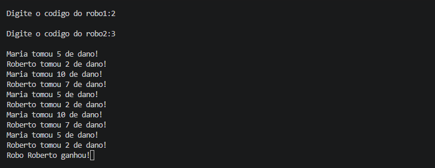
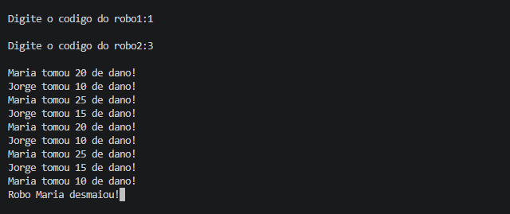

Jorge (ofensivo) x Roberto (defensivo):

Golpe da rodada 2, Jorge ataca Roberto: 30 + 5 (ofensivo) = 35, menos 15 de defesa = 20, rodada par + 5 = 25, defensivo - 3 = 22 de dano.

Roberto (defensivo) x Maria (equilibrada):

Golpe da rodada 1, Maria ataca Roberto: 20 - 15 = 5, dano mínimo 5, defensivo - 3 = 2 (mínimo final é 2), 2 de dano.

Jorge (ofensivo) x Maria (equilibrada):

Golpe da rodada 5, Jorge ataca Maria: 30 + 5 = 35, menos 15 de defesa = 20, rodada ímpar sem bônus, equilibrada sem redução = 20. Maria só tinha 10 de energia, então tomou 10 e desmaiou.

Herança: RoboOfensivo, RoboDefensivo e RoboEquilibrado herdam de Robo (abstrata) e usam super nos construtores.

Polimorfismo: todos ficam no mesmo ArrayList<Robo> e o combate chama atacar sem saber o tipo. O ofensivo sobrescreve calcularAtaque() (+5) e o defensivo sobrescreve ajustarDanoRecebido() (-3, mínimo 2).

Encapsulamento: atributos private, sem setters. Energia e pontos só mudam por métodos de Robo, como receberDano, recuperarEnergia e registrarVitoria.
